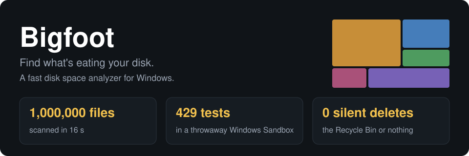
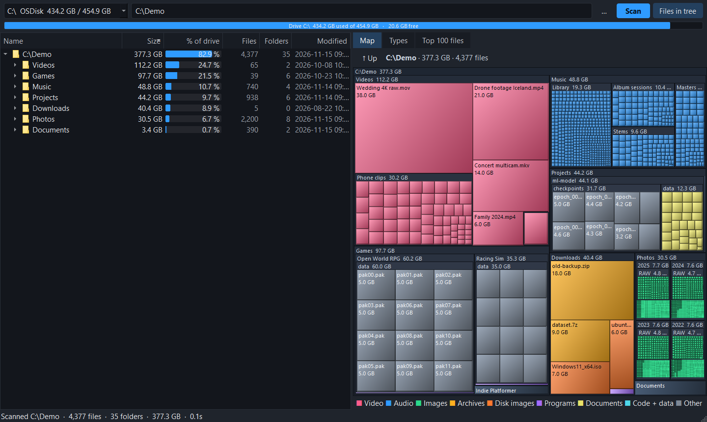
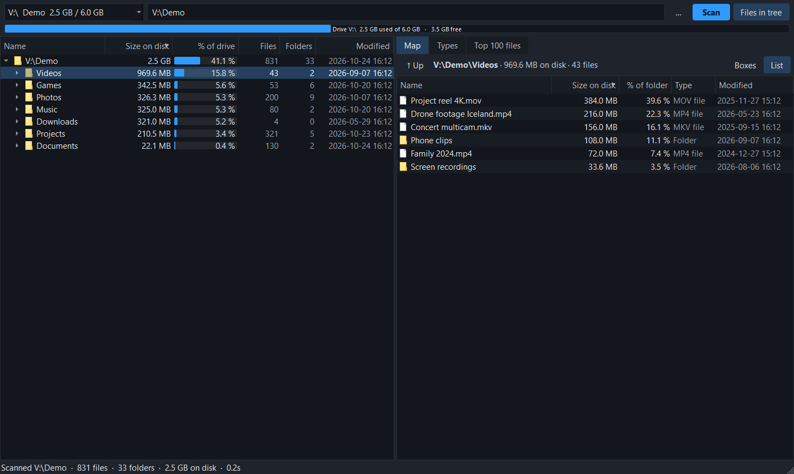
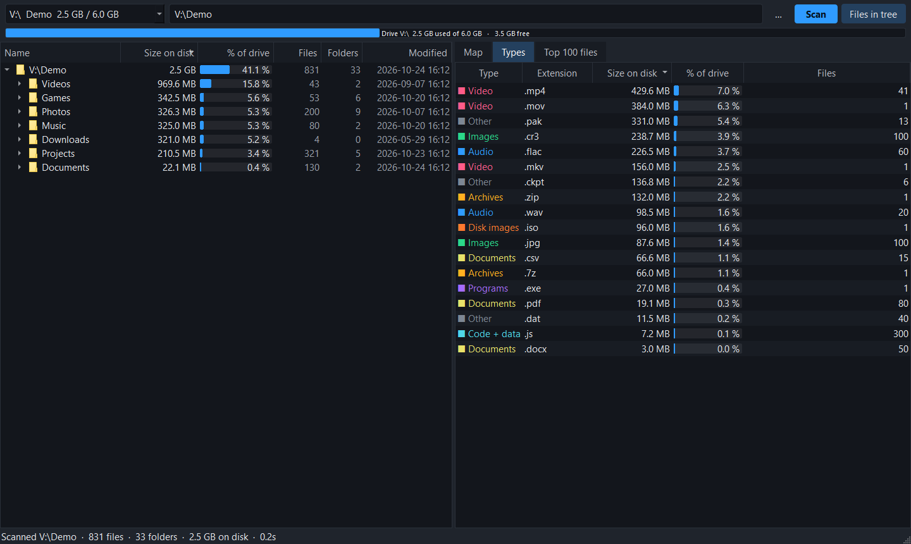
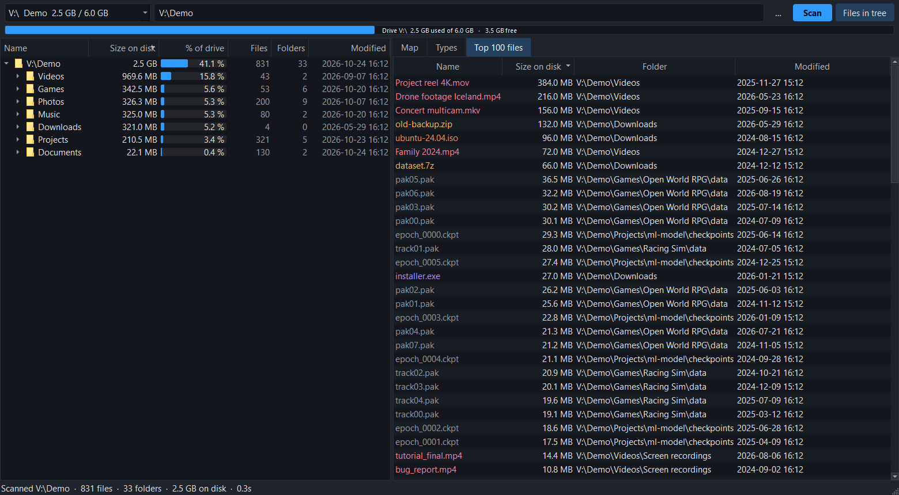

<p align="center">
  <a href="https://github.com/AARROWdev/bigfoot/releases/latest">
    <picture>
      <source media="(prefers-color-scheme: dark)" srcset="docs/hero-dark.svg">
      <source media="(prefers-color-scheme: light)" srcset="docs/hero-light.svg">
      
    </picture>
  </a>
</p>

# Bigfoot

**Download: [latest release](https://github.com/AARROWdev/bigfoot/releases/latest)** (Windows 10/11, 64-bit)

Find what's eating your disk. Bigfoot is a disk space analyzer for Windows that shows where your space goes at a glance: a treemap of every folder, a plain list view, real size on disk, and it only ever sends files to the Recycle Bin, refusing anything Windows would delete for good.

Point it at a drive or folder and it shows where the space went: a biggest-first tree, a treemap, a breakdown by file type and the 100 biggest files. Select what you don't need and send it to the Recycle Bin; the totals update on the spot.



| The same folder as a list | Types | Top 100 files |
|---|---|---|
|  |  |  |

## Download
From the [latest release](https://github.com/AARROWdev/bigfoot/releases/latest):
- **BigfootSetup-&lt;version&gt;.exe** (recommended): installs to Program Files with a Start Menu entry. Run it again to upgrade; it closes Bigfoot if it's open.
- **Bigfoot-&lt;version&gt;-portable-win64.zip**: unzip anywhere and run `Bigfoot.exe`. Nothing is installed.

The app isn't code-signed yet, so Windows may show "Windows protected your PC": click **More info**, then **Run anyway**.

**Uninstall:** Settings > Apps > Bigfoot > Uninstall (portable: delete the folder). Your settings stay in the registry (`HKCU\Software\Bigfoot`); delete that key to remove them too.

## What it does
- **Scans** any drive, folder or network share: multi-threaded, with live progress, and the tree fills in while it scans
- **Biggest-first tree:** size on disk, % of drive bar, files, folders, newest modified date. Click any column to sort.
- **Map:** a squarified treemap of the selected folder, colored by file type. Click to find it in the tree, double-click a folder to zoom in, right-click or Up to zoom out.
- **Boxes | List:** the switch above the map shows the selected folder as boxes or as a list (name, size on disk, % of the folder, type, modified; folders and files together, biggest first, click a header to sort). Double-click a folder to open it, a file to open it with its app; right-click gives the same menu as everywhere else. Bigfoot remembers which one you used.
- **Types:** space by extension and category (video, audio, images, archives, disk images, programs, documents, code)
- **Top 100 files** under the selected folder
- **Actions:** open, show in Explorer, copy path, scan only this folder, send to Recycle Bin
- Drive picker with a used/free bar

| Key | Action |
|---|---|
| F5 | Rescan |
| Ctrl+L | Type a path |
| Delete | Send selection to Recycle Bin |
| Ctrl+C | Copy path |
| Backspace (on map) | Zoom out |

Folders Windows won't let you read are counted as "access denied" in the status bar; run as administrator to include them.

## Sizes are what the files take on disk
Bigfoot ranks and totals the space a file occupies on the drive, not the length it claims, so the totals add up and a drive's total stays within what Windows says is used. For an ordinary file that is its exact length; Explorer's "Size on disk" rounds every file up to whole clusters, so it can show a little more:
- **Sparse files** (VM disks, databases, test placeholders) count what they hold. A 400 GB sparse file that holds nothing counts 0.
- **Compressed files** (NTFS compression, Windows "compact OS") count their compressed size.
- **Cloud placeholders** (OneDrive "online-only" files) count 0 and are never opened, so a scan can't make them download.
- **Hard links** (the same file under several names, as in WinSxS) count once. The first name by path takes the size; the other names are listed with 0.

The columns say "Size on disk". The one place Bigfoot goes by a file's length is the Recycle Bin check below, because that is what Windows compares with the bin's size. Telling hard links apart takes one attribute lookup per file (never a read), which adds scan time on a drive with millions of files (the whole-C: row below includes it).

## The part worth reading: delete means recycle
A disk cleaner's worst bug is deleting something for good. Qt's `QFile.moveToTrash` (like the shell call underneath it) will quietly delete a file permanently and still report success when the Recycle Bin can't take it. Bigfoot checks before it sends anything, and refuses with a reason instead:

- **No Recycle Bin on that drive:** USB sticks, SD cards, CD/DVD, RAM disks, anything that isn't a fixed drive
- **Recycling turned off** for that drive (`NukeOnDelete`)
- **Too big for the bin:** each item is checked against the drive's bin size (its `MaxCapacity` setting, or the Windows default of 5% if it was never changed), lowered to the `RecycleBinSize` Group Policy when that is smaller. A selection too big for the bin *together* is refused too, because Windows would otherwise purge the items it recycled seconds earlier.
- **Size not known:** a folder only partly scanned because you pressed Stop
- **Names Windows can't recycle:** trailing dots or spaces, unpaired surrogates, device names like `CON`, `NUL.txt`, `COM1`

## Tested in a throwaway Windows
`tests/` holds 500 automated tests that run inside a fresh Windows Sandbox (495 of them; the other 5 are skipped there: 3 need a virtual disk, which the Sandbox can't mount, and 2 check the headless test setting, which the Sandbox doesn't use), so nothing on a real PC is touched. Installer and black-box checks run against the **installed** app: install, upgrade (including while Bigfoot is running), uninstall. The app tests scan generated trees and check every total against an independent walk of the tree, and recycle into the real Recycle Bin, restore and compare byte for byte. The UI is driven with Qt events, and a random click-and-key monkey test (4,500 steps a run) runs with a watchdog that fails if the window stops responding for 2 seconds.

Release bar: all 495 pass **3 full runs in a row** on the release code. Getting there found 11 real bugs, among them 2 that deleted files for good and 2 that stopped the app from opening, all fixed and covered by a test.

| Measured in the Sandbox | |
|---|---|
| 1,000,000 empty files | 17 to 20 s |
| The whole C: drive | 72 to 258 s (3 runs: 72, 258, 74) |
| Worst window freeze during a big scan | under 0.4 s |

## Build
```
python -m venv .venv
.venv\Scripts\python -m pip install -r requirements.txt pyinstaller
winget install JRSoftware.InnoSetup   # installer compiler
.\build.ps1   # -> dist\BigfootSetup-<ver>.exe, dist\Bigfoot-<ver>-portable-win64.zip
```
`Bigfoot.bat` runs it from source. `tests\sandbox\run-tests.ps1` runs the full suite in a fresh Windows Sandbox. The screenshots above are of a folder of real files (about 2.5 GB of real data, every file at the size Bigfoot shows): `tools\make_demo.py <folder>` builds it and `tools\screenshots.py <folder>` takes them.
Settings live in the registry (`HKCU\Software\Bigfoot`); `error.log` is in `%LOCALAPPDATA%\Bigfoot\`.

## How it was built
Python and PySide6 (Qt 6), one 1,770-line file. Built with [Claude Code](https://claude.com/claude-code): a written spec of what must work and what counts as a bug, a separate AI reviewer session checking every change against it until zero findings, and the Sandbox suite above as the release gate.

## License
[MIT](LICENSE)

## Later
- NTFS master file table reader (reads the drive's file table directly, needs admin)
- Mac version
